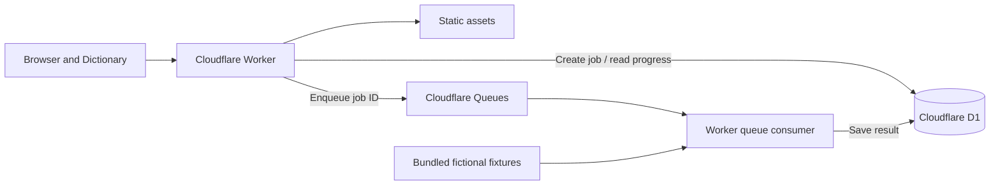

# YARN — Your App’s Risk Navigator

YARN helps beginner developers understand what a check found, what it examined, and what remains unknown. YARN started as a local prototype. This repository contains its hosted Cloudflare showcase, with two fictional examples and a built-in Dictionary of 93 coding terms.

## Run locally

Use Node.js 24 and npm. From this directory, run:

```sh
npm install
npm run db:local
npm run dev
```

Open [the local demo](http://127.0.0.1:8789/). Choose **Explore flagged example**, then **Recheck this example** → **Run synthetic checks**. Watch for the queued status and the saved D1 result. Try the quiet example to see how limited checks can return zero findings. In **Dictionary**, search for “command window” or use the letter shortcuts.

In a second terminal, run `npm test` and `npm run test:integration` with Wrangler running. The integration test verifies the Worker routes, real local Queue delivery, both D1 results, and the Dictionary assets. Wrangler simulates D1 and Queues locally.

## Architecture



The Worker accepts only the two named synthetic examples. Codex Security is unavailable in the hosted showcase. The local prototype supports an optional connection. No upload, file-system access, paid scan, or external advisory lookup is available. The consumer derives evidence from the bundled fixtures by checking dependency version declarations, lockfile presence, and TypeScript strictness. Browser sessions have isolated run histories. The demo marks unfinished jobs as failed after two minutes and prunes expired records on subsequent rechecks.

## Contest changes and provenance

- Reused the existing YARN interface, Dictionary, and fictional fixtures from the existing local YARN prototype.
- Added the Workers API and static asset configuration, a D1 migration and per-session history, a Queues producer and consumer, and an end-to-end integration test.
- Wrangler is a Cloudflare development dependency, pinned in the package manifest. [Workers](https://developers.cloudflare.com/workers/) · [D1](https://developers.cloudflare.com/d1/) · [Queues](https://developers.cloudflare.com/queues/)

## Submission status

The [hosted judge demo](https://yarn-contest-f5277659.seolynn07.workers.dev/) uses the dedicated Worker and D1 database `yarn-contest-f5277659` and the Queue `yarn-contest-f5277659-rechecks`. The hosted integration test passes for both bundled examples. The included Wrangler configuration uses a placeholder database ID for local development.

[Download the 24-second product demo](https://github.com/seolynn07-boop/yarn-cloudflare-contest/releases/download/contest-demo/YARN-contest-demo.mp4).
